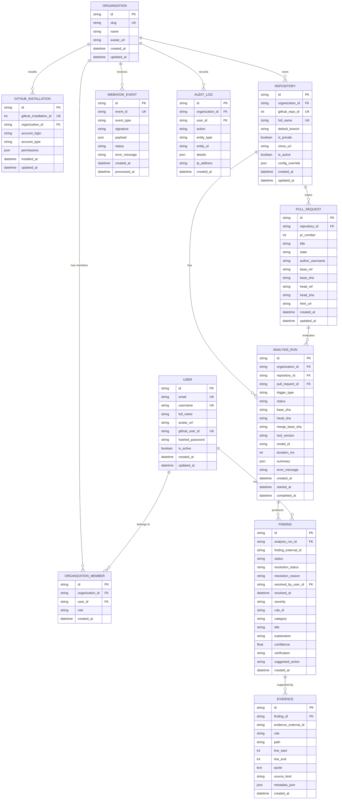

# DocSentry — Database Schema Specification
**Version:** 0.2.0-schema  
**Target Relational DBMS:** PostgreSQL 15+ / SQLite 3.38+ (Local & Test)  
**ORM:** SQLAlchemy 2.0 (Mapped declarative dataclasses)

---

## 1. Schema Design Philosophy

The DocSentry database model is engineered around three non-negotiable operational principles:
1. **Strict Multi-Tenancy:** The `Organization` is the primary tenancy boundary. Repositories, analysis runs, findings, and audit logs are scoped directly or through hierarchical foreign keys to an organization.
2. **Immutability of Evidence & Historical Auditing:** An `AnalysisRun` represents a point-in-time scan of a git snapshot. Historical runs and their associated findings and evidence are **never overwritten**. When a PR is updated with new commits, a new `AnalysisRun` is recorded.
3. **Source Code Privacy:** DocSentry stores only metadata, diff hunks, and extracted quotes necessary for evidence presentation. Entire repositories, AST trees, and unrelated files are never stored in the database.

---

## 2. Entity-Relationship Overview

---

## 3. Detailed Table Specifications

### 3.1 `users`
Represents an individual user account.

| Column | Type | Constraints | Description |
|---|---|---|---|
| `id` | VARCHAR(36) | PRIMARY KEY | UUIDv4 identifier. |
| `email` | VARCHAR(255) | NOT NULL, UNIQUE, INDEX | User email address. |
| `username` | VARCHAR(100) | NOT NULL, UNIQUE, INDEX | User handle. |
| `full_name` | VARCHAR(255) | NULL | Display name. |
| `avatar_url` | VARCHAR(512) | NULL | Avatar URL. |
| `github_user_id` | VARCHAR(100) | NULL, UNIQUE, INDEX | GitHub user identifier from OAuth. |
| `hashed_password` | VARCHAR(255) | NULL | Hashed password for direct logins. |
| `is_active` | BOOLEAN | NOT NULL, DEFAULT TRUE | Account active flag. |
| `created_at` | TIMESTAMP WITH TIME ZONE | NOT NULL, DEFAULT now() | Creation timestamp. |
| `updated_at` | TIMESTAMP WITH TIME ZONE | NOT NULL, DEFAULT now() | Last update timestamp. |

### 3.2 `organizations`
Tenancy boundary representing an organization or workspace.

| Column | Type | Constraints | Description |
|---|---|---|---|
| `id` | VARCHAR(36) | PRIMARY KEY | UUIDv4 identifier. |
| `slug` | VARCHAR(100) | NOT NULL, UNIQUE, INDEX | URL-safe org slug (e.g., `acme-corp`). |
| `name` | VARCHAR(255) | NOT NULL | Display name. |
| `avatar_url` | VARCHAR(512) | NULL | Organization logo URL. |
| `created_at` | TIMESTAMP WITH TIME ZONE | NOT NULL, DEFAULT now() | Creation timestamp. |
| `updated_at` | TIMESTAMP WITH TIME ZONE | NOT NULL, DEFAULT now() | Last update timestamp. |

### 3.3 `organization_members`
Association table connecting users to organizations with RBAC.

| Column | Type | Constraints | Description |
|---|---|---|---|
| `id` | VARCHAR(36) | PRIMARY KEY | UUIDv4 identifier. |
| `organization_id` | VARCHAR(36) | NOT NULL, FK(`organizations.id` ON DELETE CASCADE), INDEX | Scoped organization. |
| `user_id` | VARCHAR(36) | NOT NULL, FK(`users.id` ON DELETE CASCADE), INDEX | Scoped user. |
| `role` | VARCHAR(50) | NOT NULL, DEFAULT 'member' | Role: `owner`, `admin`, `member`, `viewer`. |
| `created_at` | TIMESTAMP WITH TIME ZONE | NOT NULL, DEFAULT now() | Joined timestamp. |

*Unique Constraint:* `uq_org_member (organization_id, user_id)`

### 3.4 `github_installations`
Tracks GitHub App installations linked to an organization.

| Column | Type | Constraints | Description |
|---|---|---|---|
| `id` | VARCHAR(36) | PRIMARY KEY | UUIDv4 identifier. |
| `github_installation_id` | BIGINT | NOT NULL, UNIQUE, INDEX | ID supplied by GitHub. |
| `organization_id` | VARCHAR(36) | NOT NULL, FK(`organizations.id` ON DELETE CASCADE), INDEX | Scoped organization. |
| `account_login` | VARCHAR(255) | NOT NULL | GitHub org or user login. |
| `account_type` | VARCHAR(50) | NOT NULL | `Organization` or `User`. |
| `permissions` | JSON / JSONB | NULL | Stored permission scopes. |
| `installed_at` | TIMESTAMP WITH TIME ZONE | NOT NULL, DEFAULT now() | Installed timestamp. |
| `updated_at` | TIMESTAMP WITH TIME ZONE | NOT NULL, DEFAULT now() | Updated timestamp. |

### 3.5 `repositories`
Tracked Git repositories.

| Column | Type | Constraints | Description |
|---|---|---|---|
| `id` | VARCHAR(36) | PRIMARY KEY | UUIDv4 identifier. |
| `organization_id` | VARCHAR(36) | NOT NULL, FK(`organizations.id` ON DELETE CASCADE), INDEX | Tenant organization. |
| `github_repo_id` | BIGINT | NOT NULL, UNIQUE, INDEX | GitHub repository ID. |
| `full_name` | VARCHAR(255) | NOT NULL, UNIQUE, INDEX | Full name (e.g. `Atharv386/DocSentary`). |
| `default_branch` | VARCHAR(100) | NOT NULL, DEFAULT 'main' | Main branch name. |
| `is_private` | BOOLEAN | NOT NULL, DEFAULT FALSE | Repository privacy flag. |
| `clone_url` | VARCHAR(512) | NOT NULL | Git clone URL. |
| `is_active` | BOOLEAN | NOT NULL, DEFAULT TRUE | Whether scans are active. |
| `config_override` | JSON / JSONB | NULL | Custom scan config overrides. |
| `created_at` | TIMESTAMP WITH TIME ZONE | NOT NULL, DEFAULT now() | Creation timestamp. |
| `updated_at` | TIMESTAMP WITH TIME ZONE | NOT NULL, DEFAULT now() | Last update timestamp. |

### 3.6 `pull_requests`
Pull requests under tracking.

| Column | Type | Constraints | Description |
|---|---|---|---|
| `id` | VARCHAR(36) | PRIMARY KEY | UUIDv4 identifier. |
| `repository_id` | VARCHAR(36) | NOT NULL, FK(`repositories.id` ON DELETE CASCADE), INDEX | Parent repository. |
| `pr_number` | INTEGER | NOT NULL | GitHub PR number. |
| `title` | VARCHAR(512) | NOT NULL | PR title. |
| `state` | VARCHAR(50) | NOT NULL, DEFAULT 'open' | `open`, `closed`, `merged`. |
| `author_username` | VARCHAR(100) | NOT NULL | PR author. |
| `base_ref` | VARCHAR(255) | NOT NULL | Base branch (e.g. `main`). |
| `base_sha` | VARCHAR(40) | NOT NULL | Base commit SHA. |
| `head_ref` | VARCHAR(255) | NOT NULL | Head branch. |
| `head_sha` | VARCHAR(40) | NOT NULL | Head commit SHA. |
| `html_url` | VARCHAR(512) | NOT NULL | GitHub PR URL. |
| `created_at` | TIMESTAMP WITH TIME ZONE | NOT NULL, DEFAULT now() | PR opened timestamp. |
| `updated_at` | TIMESTAMP WITH TIME ZONE | NOT NULL, DEFAULT now() | Last synchronized timestamp. |

*Unique Constraint:* `uq_repo_pr (repository_id, pr_number)`

### 3.7 `analysis_runs`
An individual execution of the DocSentry drift detection engine.

| Column | Type | Constraints | Description |
|---|---|---|---|
| `id` | VARCHAR(36) | PRIMARY KEY | UUIDv4 identifier. |
| `organization_id` | VARCHAR(36) | NOT NULL, FK(`organizations.id` ON DELETE CASCADE), INDEX | Scoped organization. |
| `repository_id` | VARCHAR(36) | NOT NULL, FK(`repositories.id` ON DELETE CASCADE), INDEX | Scoped repository. |
| `pull_request_id` | VARCHAR(36) | NULL, FK(`pull_requests.id` ON DELETE CASCADE), INDEX | Associated PR (if PR scan). |
| `trigger_type` | VARCHAR(50) | NOT NULL | `webhook_pr_opened`, `webhook_pr_sync`, `manual`, `cli`. |
| `status` | VARCHAR(50) | NOT NULL, DEFAULT 'queued', INDEX | `queued`, `processing`, `completed`, `failed`, `cancelled`. |
| `base_sha` | VARCHAR(40) | NOT NULL | Base commit SHA evaluated. |
| `head_sha` | VARCHAR(40) | NOT NULL | Head commit SHA evaluated. |
| `merge_base_sha` | VARCHAR(40) | NOT NULL | Computed merge-base SHA. |
| `tool_version` | VARCHAR(50) | NOT NULL | DocSentry version (e.g. `0.2.0`). |
| `model_id` | VARCHAR(100) | NULL | Model ID if AI verified (e.g. `qwen3:8b`). |
| `duration_ms` | INTEGER | NOT NULL, DEFAULT 0 | Run time in milliseconds. |
| `summary` | JSON / JSONB | NULL | Stats: `{drift: 1, changed_files: 3, ...}`. |
| `error_message` | TEXT | NULL | Error traceback if failed. |
| `created_at` | TIMESTAMP WITH TIME ZONE | NOT NULL, DEFAULT now() | Job creation timestamp. |
| `started_at` | TIMESTAMP WITH TIME ZONE | NULL | Processing start timestamp. |
| `completed_at` | TIMESTAMP WITH TIME ZONE | NULL | Processing completion timestamp. |

### 3.8 `findings`
Individual documentation drift findings generated by a run.

| Column | Type | Constraints | Description |
|---|---|---|---|
| `id` | VARCHAR(36) | PRIMARY KEY | UUIDv4 identifier. |
| `analysis_run_id` | VARCHAR(36) | NOT NULL, FK(`analysis_runs.id` ON DELETE CASCADE), INDEX | Parent analysis run. |
| `finding_external_id`| VARCHAR(100) | NOT NULL | Engine-generated finding ID (e.g. `DCS-001`). |
| `status` | VARCHAR(50) | NOT NULL | `DRIFT`, `POTENTIAL_DRIFT`, `NO_DRIFT`, `UNCERTAIN`. |
| `resolution_status` | VARCHAR(50) | NOT NULL, DEFAULT 'open', INDEX | `open`, `acknowledged`, `dismissed`, `resolved`. |
| `resolution_reason` | TEXT | NULL | User explanation for resolution. |
| `resolved_by_user_id`| VARCHAR(36) | NULL, FK(`users.id` ON DELETE SET NULL) | User who updated resolution. |
| `resolved_at` | TIMESTAMP WITH TIME ZONE | NULL | Resolution timestamp. |
| `severity` | VARCHAR(50) | NOT NULL | `critical`, `high`, `medium`, `low`, `info`. |
| `rule_id` | VARCHAR(100) | NOT NULL, INDEX | Detection rule (e.g. `RULE_PARAM_DEFAULT_CHANGED`). |
| `category` | VARCHAR(100) | NOT NULL | Category (e.g. `signature_drift`). |
| `title` | VARCHAR(512) | NOT NULL | Finding title. |
| `explanation` | TEXT | NOT NULL | Detailed explanation of drift. |
| `confidence` | FLOAT | NULL | Confidence score (0.0 - 1.0). |
| `verification` | VARCHAR(50) | NOT NULL | `deterministic`, `model_assisted`, `human_fixture`. |
| `suggested_action` | TEXT | NULL | Recommended remediation for dev. |
| `created_at` | TIMESTAMP WITH TIME ZONE | NOT NULL, DEFAULT now() | Record timestamp. |

### 3.9 `evidence`
Granular evidence anchors supporting each finding.

| Column | Type | Constraints | Description |
|---|---|---|---|
| `id` | VARCHAR(36) | PRIMARY KEY | UUIDv4 identifier. |
| `finding_id` | VARCHAR(36) | NOT NULL, FK(`findings.id` ON DELETE CASCADE), INDEX | Parent finding. |
| `evidence_external_id`| VARCHAR(100) | NOT NULL | Engine-generated evidence ID. |
| `role` | VARCHAR(50) | NOT NULL | `code` or `documentation`. |
| `path` | VARCHAR(512) | NOT NULL | Relative file path. |
| `line_start` | INTEGER | NOT NULL | Start line (1-indexed). |
| `line_end` | INTEGER | NOT NULL | End line (inclusive). |
| `quote` | TEXT | NOT NULL | Relevant code hunk or doc statement. |
| `source_kind` | VARCHAR(50) | NOT NULL | `ast_fact`, `diff_hunk`, `doc_span`. |
| `metadata_json` | JSON / JSONB | NULL | AST symbol details, param name, etc. |
| `created_at` | TIMESTAMP WITH TIME ZONE | NOT NULL, DEFAULT now() | Record timestamp. |

### 3.10 `webhook_events`
Audit log of inbound GitHub webhook deliveries for deduplication and debugging.

| Column | Type | Constraints | Description |
|---|---|---|---|
| `id` | VARCHAR(36) | PRIMARY KEY | UUIDv4 identifier. |
| `event_id` | VARCHAR(100) | NOT NULL, UNIQUE, INDEX | `X-GitHub-Delivery` GUID. |
| `event_type` | VARCHAR(100) | NOT NULL | Event name (e.g. `pull_request`). |
| `signature` | VARCHAR(255) | NOT NULL | `X-Hub-Signature-256`. |
| `payload` | JSON / JSONB | NOT NULL | Raw webhook payload. |
| `status` | VARCHAR(50) | NOT NULL, DEFAULT 'received' | `received`, `processed`, `ignored`, `failed`. |
| `error_message` | TEXT | NULL | Processing error details. |
| `created_at` | TIMESTAMP WITH TIME ZONE | NOT NULL, DEFAULT now() | Inbound arrival timestamp. |
| `processed_at` | TIMESTAMP WITH TIME ZONE | NULL | Processing completion timestamp. |

### 3.11 `audit_logs`
Security and administrative trail of important events.

| Column | Type | Constraints | Description |
|---|---|---|---|
| `id` | VARCHAR(36) | PRIMARY KEY | UUIDv4 identifier. |
| `organization_id` | VARCHAR(36) | NOT NULL, FK(`organizations.id` ON DELETE CASCADE), INDEX | Scoped organization. |
| `user_id` | VARCHAR(36) | NULL, FK(`users.id` ON DELETE SET NULL) | Actor user (NULL for system/webhook). |
| `action` | VARCHAR(100) | NOT NULL | Action name (e.g. `finding.resolved`, `repo.connected`). |
| `entity_type` | VARCHAR(50) | NOT NULL | Entity type (e.g. `finding`, `repository`). |
| `entity_id` | VARCHAR(36) | NOT NULL | ID of affected entity. |
| `details` | JSON / JSONB | NULL | Diff of changed attributes or metadata. |
| `ip_address` | VARCHAR(45) | NULL | Client IP address. |
| `created_at` | TIMESTAMP WITH TIME ZONE | NOT NULL, DEFAULT now() | Action timestamp. |

---

## 4. Indexing & Optimization Strategy

1. **Multi-Tenancy Indexing:** All queries filtering by `organization_id` use compound indexes with foreign keys:
   - `idx_repos_org_created (organization_id, created_at DESC)`
   - `idx_analyses_org_status (organization_id, status)`
   - `idx_findings_run_status (analysis_run_id, status)`
2. **Pull Request Lookup:** `idx_pr_repo_number (repository_id, pr_number)` is uniquely indexed for O(1) webhook resolution.
3. **Webhook Deduplication:** `event_id` is indexed with a unique constraint. If GitHub redelivers the same event ID within retry windows, the unique violation prevents duplicate analysis execution.
4. **Cascade Behavior:** Deleting an organization cleanly cascades to all its members, repositories, PRs, analyses, and findings. Deleting a user nullifies `resolved_by_user_id` without deleting historical findings.
