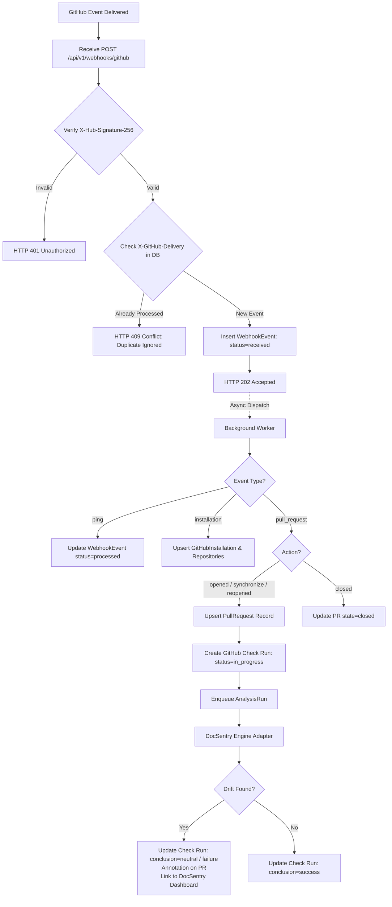

# DocSentry — GitHub Integration Architecture
**Version:** 0.2.0-gh  
**Integration Type:** GitHub App (First-Class Integration)

---

## 1. Why GitHub App Over Personal Access Tokens (PATs)

DocSentry utilizes a dedicated **GitHub App** rather than personal access tokens or OAuth tokens for continuous documentation drift analysis:
- **Fine-Grained Permissions:** GitHub Apps request only repository-level permissions without granting read/write access to unrelated personal or corporate codebases.
- **Organization Identity:** Actions appear under the bot identity (e.g. `docsentry[bot]`), cleanly separating automated PR checks from developer accounts.
- **Short-Lived Installation Tokens:** Bearer tokens expire automatically after 1 hour, minimizing credential leakage risks.
- **Native Check Runs & Statuses:** Can post rich GitHub Check Runs with failure annotations and deep links back to the DocSentry Evidence Inspector.

---

## 2. GitHub App Configuration

### App Settings
- **Name:** `DocSentry`
- **Homepage URL:** `https://docsentry.dev`
- **Webhook URL:** `https://api.docsentry.dev/api/v1/webhooks/github`
- **Webhook Secret:** Configured via `DOCSENTRY_GITHUB_WEBHOOK_SECRET`

### Required Permissions
| Scope | Level | Justification |
|---|---|---|
| **Pull Requests** | Read & Write | Receive PR lifecycle webhooks, read PR metadata, and post inline comments or review feedback. |
| **Checks** | Read & Write | Create and update GitHub Check Runs on pull requests reflecting drift status. |
| **Contents** | Read-Only | Read repository files at specific commit SHAs (only via Git tree/blob APIs; no code execution). |
| **Metadata** | Read-Only | Basic repository identification and user handles. |

### Subscribed Webhook Events
- `pull_request` (actions: `opened`, `synchronize`, `reopened`, `closed`)
- `installation` (actions: `created`, `deleted`, `suspend`, `unsuspend`)
- `installation_repositories` (actions: `added`, `removed`)
- `ping`

---

## 3. Webhook Lifecycle & Deduplication



### Signature Verification Algorithm
```python
import hmac
import hashlib

def verify_github_signature(payload_bytes: bytes, signature_header: str, secret: str) -> bool:
    if not signature_header or not signature_header.startswith("sha256="):
        return False
    expected = hmac.new(secret.encode("utf-8"), payload_bytes, hashlib.sha256).hexdigest()
    actual = signature_header.removeprefix("sha256=")
    return hmac.compare_digest(expected, actual)
```

---

## 4. GitHub Check Runs & Deep Linking

When an analysis is completed, DocSentry writes a GitHub Check Run on the head commit:

- **Check Run Name:** `DocSentry / Documentation Drift`
- **Details URL:** `https://app.docsentry.dev/repos/{owner}/{repo}/pulls/{pr_number}/analyses/{analysis_id}`
- **Summary:**
  - `Total Documentation Drift Findings: 1`
  - `Rules Evaluated: Deterministic AST & Signature Matchers`
  - `Provenance: DETERMINISTIC RULE ENGINE (100% confidence)`
- **Annotations:**
  - File: `README.md`
  - Start Line: `42`, End Line: `44`
  - Title: `Default parameter value changed in code`
  - Message: `src/client.py updated 'timeout' default to 60, but README.md states default is 30.`

This provides immediate, actionable feedback directly in GitHub's PR checks tab while linking the developer to the full DocSentry Evidence Inspector.
