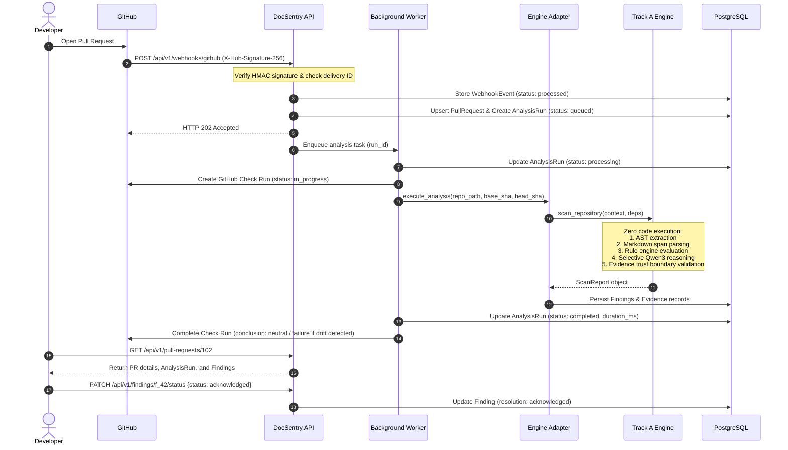

# DocSentry — Full-Stack Product Architecture
**Version:** 0.2.0-prod-arch  
**Track:** Track B — Product Engineering & Platform  
**Target Platform:** Multi-tenant Developer Infrastructure for Automated Documentation Drift Detection

---

## 1. Executive Summary

DocSentry solves a critical engineering problem: **code evolves continuously, but documentation silently drifts into inaccuracy.** 

Unlike code tests or linters that verify code correctness against code expectations, DocSentry verifies that natural-language documentation (Markdown statements, API guides, configuration manuals, parameter docs) accurately reflects the actual AST structures, signatures, defaults, and behavioral contracts of the underlying codebase.

DocSentry is structured into two independent development tracks:
- **Track A (Core Intelligence):** Deterministic AST extraction, Markdown claim extraction, rule-based drift detection, selective Qwen3-8B verification, evidence trust boundary validation, and empirical benchmarks.
- **Track B (Product Engineering):** Full-stack developer product architecture, including multi-tenant web application, REST API, relational database persistence, background worker queues, GitHub App integration (webhooks, check runs, review comments), and an evidence-inspection UX.

This document specifies the end-to-end architecture of Track B, ensuring strict decoupling from Track A while preserving the independent usability of the CLI and detection engine.

---

## 2. High-Level System Topology

```
+-----------------------------------------------------------------------------------+
|                                  USER / BROWSER                                   |
|                                                                                   |
|  +--------------------+  +----------------------+  +---------------------------+  |
|  | Landing & Product  |  | Multi-Tenant App     |  | Evidence Inspector        |  |
|  | Marketing Site     |  | Dashboard & Repos    |  | Side-by-Side Verification |  |
|  +--------------------+  +----------------------+  +---------------------------+  |
|                                     |                                             |
|                                     v HTTPS (JSON API)                            |
+-----------------------------------------------------------------------------------+
                                      |
                                      v
+-----------------------------------------------------------------------------------+
|                              DOCSENTRY BACKEND API                                |
|                                (FastAPI 0.115+)                                   |
|                                                                                   |
|  +-----------------------------------------------------------------------------+  |
|  | API Router: /auth, /orgs, /repos, /pull-requests, /analyses, /findings      |  |
|  +-----------------------------------------------------------------------------+  |
|  | Core & Middleware: Multi-Tenancy Guard, JWT Auth, Webhook HMAC Verification  |  |
|  +-----------------------------------------------------------------------------+  |
|  | Service Layer: RepoService, AnalysisService, FindingService, GitHubService  |  |
|  +-----------------------------------------------------------------------------+  |
+-----------------------------------------------------------------------------------+
             |                                    |                        |
             v                                    v                        v
+------------------------+             +--------------------+    +------------------+
|   PostgreSQL / SQLite  |             | Asynchronous Queue |    | GitHub API       |
|   Relational Store     |             | & Background Worker|    | (Octokit / REST) |
|                        |             |                    |    |                  |
| - Users & Orgs         |             | - Job dispatch     |    | - App Webhooks   |
| - Repos & PRs          |             | - Deduplication    |    | - PR Check Runs  |
| - Analyses & Findings  |             | - State transitions|    | - Status Checks  |
| - Evidence Records     |             +--------------------+    +------------------+
+------------------------+                        |
                                                  v
                               +-------------------------------------+
                               |       DOCSENTRY ENGINE ADAPTER      |
                               |  - Sandboxed Git snapshot isolation |
                               |  - Zero-repo-code-execution         |
                               |  - Invokes `pipeline.py` (Track A)  |
                               |  - Normalizes ScanReport to DB      |
                               +-------------------------------------+
                                                  |
                                                  v
                               +-------------------------------------+
                               |     TRACK A CORE DETECTION ENGINE   |
                               |  (Frozen v0.2 / cb6234f Baseline)   |
                               |  - Python AST comparison            |
                               |  - Markdown span extraction         |
                               |  - Deterministic Rule Engine        |
                               |  - Selective Qwen3-8B Verifier      |
                               |  - Evidence Trust Boundary Check    |
                               +-------------------------------------+
```

---

## 3. Core Architectural Principles

1. **Non-Invasive Engine Isolation:** The backend interacts with the detection engine solely through an adapter (`DocSentryEngineAdapter`). The core intelligence (`src/docsentry/pipeline.py`, `src/docsentry/rules/`, `src/docsentry/extractors/`) remains 100% functional via the standalone Typer CLI (`docsentry scan`).
2. **Zero Untrusted Code Execution:** DocSentry operates exclusively through static Python AST parsing (`ast.parse`) and Git object inspection (`git diff`, `git show`). It **never** runs `import`, `setup.py`, `pytest`, or dynamic code execution on repository files.
3. **Strict Multi-Tenant Isolation:** All data access is scoped to an `Organization`. Foreign keys, database indexes, and API middleware ensure no organization can view or mutate another organization's repositories, PRs, or findings.
4. **Asynchronous & Non-Blocking Analysis:** Analysis of large diffs is delegated to a background task queue. HTTP webhook endpoints acknowledge GitHub within 200ms and report progress through persistent `AnalysisRun` state machines.
5. **Idempotent Webhook Processing:** Webhooks from GitHub are deduplicated using `X-GitHub-Delivery` tracking and commit-SHA state checking to prevent redundant, expensive analyses.
6. **Deterministic Provenance & Evidence First:** Findings are never vague assertions. Every finding must retain its exact line numbers, source quotes, diff hunks, AST facts, verification provenance (`DETERMINISTIC`, `QWEN3-8B VERIFIED`, `EVIDENCE VALIDATED`), and confidence levels.

---

## 4. Subsystem Breakdown

### 4.1 Frontend Client (`/web`)
- **Technology:** React 18, TypeScript 5.6, Vite 5.4, Tailwind CSS 3.4, Lucide Icons.
- **Role:** Delivers a technical, high-density, dark-mode developer UI.
- **Modules:**
  - *Landing Page:* High-credibility overview of documentation drift, AST-vs-doc diffing, and GitHub workflow integration.
  - *Authentication:* GitHub OAuth / token session manager with setup-state guides.
  - *Main Dashboard:* Aggregated drift metrics, active PR monitoring, and repository health.
  - *Repository Detail:* Per-repo scan logs, drift trends, and configuration editor (`docsentry.yml`).
  - *Pull Request Analysis:* Interactive file diff tree, severity filters, and real-time scan progress indicators.
  - *Evidence Inspector:* Side-by-side documentation sentence vs. code AST facts, with provenance badges and resolution controls.
  - *Settings & Integrations:* Webhook secret configuration, GitHub App connection status, and path exclusion rules.

### 4.2 Backend API (`/backend/app`)
- **Technology:** FastAPI, Pydantic v2, SQLAlchemy 2.0, Alembic, Uvicorn.
- **Role:** Provides high-throughput REST API, session management, webhook reception, and data validation.
- **Layers:**
  - `api/v1/routes`: Route handlers for auth, orgs, repos, PRs, analyses, findings, and webhooks.
  - `core/security`: Password hashing, JWT token encoding/decoding, GitHub HMAC SHA-256 signature verification.
  - `core/dependencies`: Current user resolution, organization tenancy enforcement, database session lifecycle.
  - `db/models`: Declarative SQLAlchemy models with relational integrity and cascades.
  - `services`: Business logic coordinating database updates, GitHub notifications, and job scheduling.
  - `adapters`: Safe, isolated wrapper invoking the DocSentry engine.

### 4.3 Engine Adapter (`backend/app/adapters/engine_adapter.py`)
- **Role:** Serves as the anti-corruption layer between the backend and Track A.
- **Mechanism:**
  - Instantiates `ScanContext` and `Dependencies` from `docsentry.pipeline`.
  - Runs in a worker process or thread pool with configurable timeouts.
  - Converts `ScanReport` (Pydantic) to database model instances (`Finding`, `Evidence`).
  - Handles CLI fallback or headless execution on local / clone directories.

### 4.4 Database & Persistence
- **Technology:** PostgreSQL (production / Docker) with SQLite support (testing / local dev).
- **ORM:** SQLAlchemy 2.0 with type annotations (`Mapped`, `mapped_column`).
- **Migrations:** Alembic version-controlled migration scripts.

---

## 5. End-to-End Workflow



---

## 6. Engineering Isolation & Boundary Checklist

| Boundary | Enforcement Mechanism |
|---|---|
| **Core Engine Immutability** | No modifications to `src/docsentry/rules/`, `src/docsentry/ai/`, or `src/docsentry/extractors/`. |
| **CLI Usability** | `python -m docsentry.cli scan` continues to execute independently with 100% backward compatibility. |
| **API Independence** | Frontend never imports Python packages or internal schemas; communicated strictly via JSON API contracts. |
| **Tenant Isolation** | All SQL queries are explicitly filtered by `organization_id` derived from the validated JWT claims. |
| **Secrets Safety** | Zero storage of plain-text webhook secrets or personal tokens in client-accessible responses or logs. |
